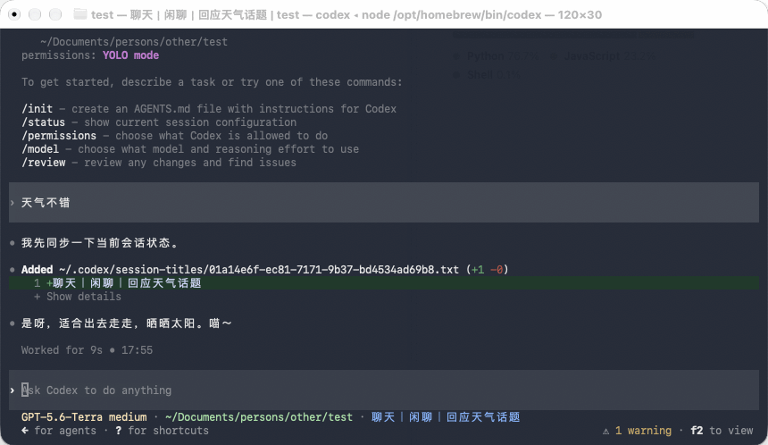

# Agent Session Titles（会话标题自动更新）

**简体中文** | [English](README.en.md)

[](https://linux.do)

为 **Codex** 和 **Claude Code** 的本地会话维护可选中文或英文的三段式标题：

```text
状态｜初始需求｜当前进展
开发中｜会话标题自动化｜适配双端安装器
Building | Session titles | Add bilingual support
```



上图为 Codex CLI：每轮对话后，窗口标题和底部状态栏的会话标题随进展即时刷新。

中间段保留用户最初要解决的问题；状态和末段在阶段变化时更新，无须等整个回合结束。当前支持的自动状态为「聊天、摸底、方案、开发中、测试、修复、待确认、已完成、搁置」。用户手动修改哪一段，插件就保留并锁定哪一段，其余段继续自动更新；手动状态词可以不在自动状态列表中。标题只有这三段，工作树和无项目会话都不额外加前缀或目录名。无法可靠拆分或确认来源的名称会整体保留；Claude Code 桌面端在首个标题确认前自动起的名字不算人工改名，插件会继续沿用自己的标题。

## 直接交给 Agent 安装

把下面这段话直接发给**有本机终端权限的 Codex 或 Claude Code Agent**。将“中文”改为“英文”即可选择英文；也可以将“两个客户端”改为“仅 Codex”或“仅 Claude Code”。Agent 会执行安装命令和检查步骤，你不需要自己打开终端。完整的中英文可复制版本见 [Agent 安装说明](AGENT_INSTALL.md)。

> 请从 https://github.com/panda-z519/agent-session-titles 安装本地会话标题插件，目标是两个客户端，标题使用中文。先检查本机 `codex`、`claude`、Node.js 20+ 和 Python 3.11+。执行 `npx --yes github:panda-z519/agent-session-titles --both --lang zh --migrate`，再核对安装结果和配置备份。`--migrate` 只用于备份并迁移旧版标题钩子，保留其他钩子。若缺少客户端或安装失败，说明具体原因，不声称成功。Codex 若要求信任新钩子，请让我在应用中检查并确认；完成后提醒我重启客户端并验证新本地会话。

## 自己运行命令安装

需要 macOS 或 Linux、Node.js 20+、Python 3.11+，以及要使用的客户端命令 `codex` 或 `claude`。选择一条命令运行：

**自动安装本机已有的客户端**（两者都有就安装两端）：

```bash
npx --yes github:panda-z519/agent-session-titles
```

**只安装 Codex：**

```bash
npx --yes github:panda-z519/agent-session-titles --codex
```

**只安装 Claude Code：**

```bash
npx --yes github:panda-z519/agent-session-titles --claude
```

**明确要求两端都安装**（缺少任一客户端命令就停止）：

```bash
npx --yes github:panda-z519/agent-session-titles --both
```

默认标题语言为中文。首次安装选择英文时加 `--lang en`；之后重跑时不指定语言会保留当前选择，切回中文可用 `--lang zh`：

`--lang` 控制插件钩子的标题格式、状态词和给 Agent 的提示。若你自己的全局 `AGENTS.md` 或 `CLAUDE.md` 仍强制另一种标题语言或“只在回复结束后更新”，安装器会提示疑似冲突的行，应同步调整；见下方[全局规则文件](#全局规则文件)。

```bash
npx --yes github:panda-z519/agent-session-titles --codex --lang en
npx --yes github:panda-z519/agent-session-titles --claude --lang zh
```

已有旧版独立标题钩子时，加 `--migrate` 才会迁移并安装插件；不加会报错并保持旧配置。迁移只删除旧标题钩子的注册条目，保留脚本、其他钩子和会话数据，并备份原配置。

### 全局规则文件

标题规则由插件钩子在每个会话中自动注入，**不需要**在全局 `AGENTS.md`（Codex）或 `CLAUDE.md`（Claude Code）里手写。安装器默认不修改这两个文件，只扫描其中疑似手写的会话标题规则，并在输出里指出行号，提醒你核对，避免和插件规则重复或冲突。

如果希望在钩子之外也把规则写进全局规则文件，可以加 `--rules`。安装器会在文件末尾写入一个由 `<!-- agent-session-titles:start -->` 和 `<!-- agent-session-titles:end -->` 包住的托管块，内容随标题语言生成，修改前会备份原文件。之后重新安装时，即使不加 `--rules`，已有的托管块也会整块更新。删除托管块（不安装插件）：

```bash
npx --yes github:panda-z519/agent-session-titles --remove-rules
```

`--remove-rules` 同样支持 `--codex` / `--claude`，只删除标记之间的内容，并保留文件其余部分。

安装器从 GitHub 读取此仓库，将插件文件复制到用户目录中的稳定位置，再调用相应客户端的插件命令。它不会在 `npm install` 阶段执行 `postinstall`。新安装的 Codex 钩子需要在 Codex 中检查并信任；随后重启对应客户端，使用新的本地会话验证。[Codex 钩子信任说明](https://learn.chatgpt.com/docs/hooks)

## 安装器会修改什么

| 客户端 | 安装和配置 |
| --- | --- |
| Codex | 注册并安装 `codex-session-titles` 插件；把 `~/.codex/session-titles/` 加入窄范围可写目录；更新前检查状态库结构并创建 SQLite 一致性备份。 |
| Claude Code | 注册并安装 `claude-session-titles` 插件；在 `~/.claude/settings.json` 中加入 `Edit(~/.cc-session-titles/**)`；改动前备份已有设置。 |

已安装旧版用户级 `session-title.sh` 的客户端需要明确传入 `--migrate`；安装器会备份后移除匹配的旧钩子注册，再安装插件。`CODEX_HOME` 和 `CLAUDE_CONFIG_DIR` 分别支持自定义两端配置目录。

## 验证标题

1. 重启客户端，新建一个**本地会话**，提出具体需求。助手理解需求后应尽早形成三段标题，阶段明显变化时更新状态与进展。
2. 分别手动修改一段标题，再让助手进入下一阶段；手动改过的段应保持原样，其他段继续更新。若把整条标题改为无法拆分的格式，插件应保留整条名称；再改回合法的三段格式后，插件恢复自动更新（中间段锁定）。
3. Codex 在标题文件写入后的工具事件尽早同步，即使 Codex 此时还没给会话起名；若 Codex 首轮结束后自动生成的名字覆盖了插件标题，下一次发消息时会恢复一次。`Stop` 和下一次发消息仍负责补偿。可检查 `~/.codex/session-titles/<会话ID>.state.json` 的 `phase`、`last_result` 和分段锁定信息。Codex CLI 使用后台守护进程（app-server daemon）时，插件经它的控制套接字调用 `thread/name/set`，已打开的 CLI 窗口会立即刷新状态栏标题；守护进程不可用（例如 `--no-daemon`）时退回直接写 SQLite，此时已打开的窗口要到重新打开或 `/rename` 后才显示新标题。侧边栏即时刷新仍取决于桌面端。
4. Claude Code 首条提示词通过官方 `sessionTitle` 钩子输出形成初始标题。**桌面端**在 Agent 写入标题文件后由 `PostToolUse` 钩子调用桌面端改名工具**立即**生效；**命令行**没有该工具，后续进展在下一次提交消息时应用（`PostToolUse` 钩子会报一条不影响流程的错误）。可检查 `~/.cc-session-titles/<会话ID>.txt`。[Claude 钩子说明](https://code.claude.com/docs/en/hooks)

历史会话在收到新消息后才重新纳入 Codex 标题管理。若钩子提示“来源未确认”，会保留已有名称。无项目会话使用需求摘要，不把当前目录冒充项目名。

## 更新与卸载

更新时重新运行相同的 `npx` 命令，并重启对应客户端。安装器可重复执行；Codex 新版本会另存状态库备份。插件名沿用 `codex-session-titles` 和 `claude-session-titles`，两端插件源统一为 `agent-session-titles`。从旧插件源名称升级时，安装器会在新插件装好后自动卸载旧插件、移除旧插件源登记并删除旧复制目录，避免钩子重复运行，无需手动处理。

卸载插件可分别运行：

```bash
codex plugin remove codex-session-titles@agent-session-titles
claude plugin uninstall claude-session-titles@agent-session-titles
```

只使用一端时运行该端的卸载命令。准备脚本添加的可写目录或 `Edit` 规则可从用户配置中单独移除；旧版独立钩子和备份不会被自动删除。

## 限制

- Codex 标题同步优先调用本机后台 app-server 的 `thread/name/set`，失败时直接写本机 `state_5.sqlite`。两者都依赖当前 Codex 的内部接口和数据库结构，属于本地集成；结构不符时准备脚本会停止配置，钩子不会创建空数据库。
- Claude Code 命令行只能在 `SessionStart` 或 `UserPromptSubmit` 通过官方钩子设置标题，本轮新写的进展要到下一次提交消息才生效；桌面端的即时改名依赖桌面端内置的 `ccd_session_mgmt` 工具。
- 即时改名按标题文件内容原样设置，锁定字段若被覆盖，会在下一次提交消息时恢复。自定义 `CC_TITLE_DIR` 时即时改名不生效（钩子条件固定匹配 `~/.cc-session-titles/`）。
- 插件只能从与上次应用标题的差异推断“外部修改”，无法证明修改者一定是用户。首次接管且没有基线的历史标题仍需保守处理。
- 本仓库的生命周期钩子面向本地桌面端，不能作为带钩子的插件提交到 OpenAI 公共插件目录。[插件打包说明](https://developers.openai.com/plugins/build/plugins)

## 社区

感谢 [LINUX DO](https://linux.do) 社区，本项目在这里发布、交流并收集佬友们的反馈。

手动安装、隔离检查与排查步骤见[使用说明](使用说明.md)。源码按 [MIT 许可证](LICENSE)开放。
